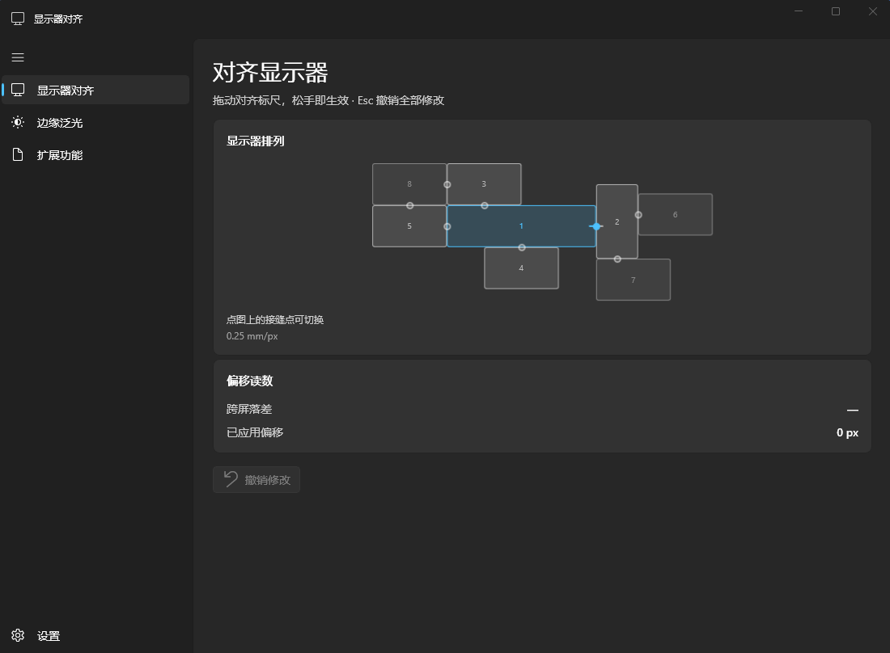
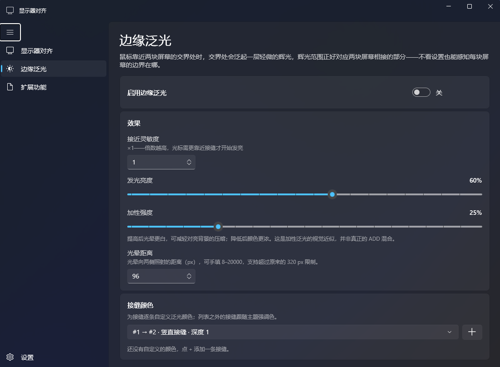
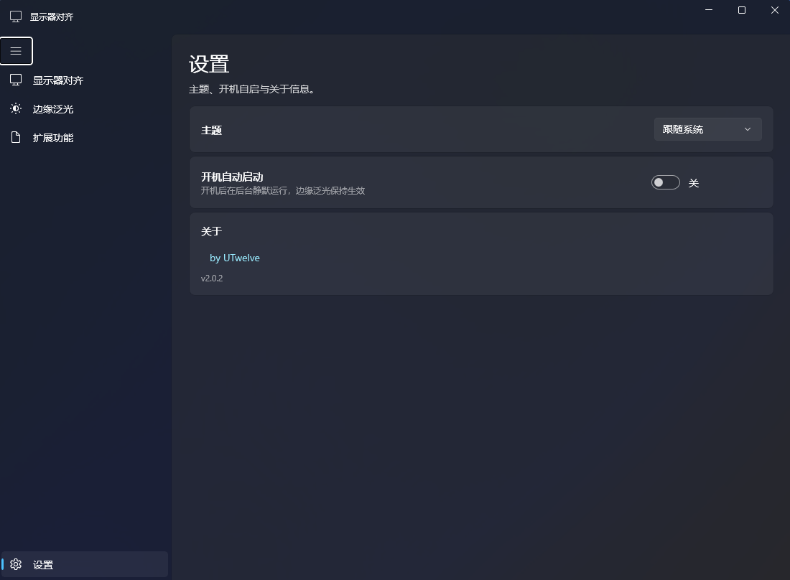

# MonitorAlign · 显示器对齐工具

把多块显示器在**视觉上真正对齐**：在接缝两侧生成可以拖动的对齐标尺，松手后自动换算成精确的显示排列偏移并写入 Windows。

WinUI 3 / .NET 9 / Windows App SDK 原生界面，Mica 材质，跟随系统明暗主题。



---

## 界面

| 显示器对齐 | 边缘泛光 |
| --- | --- |
|  |  |

| 扩展功能 | 设置 |
| --- | --- |
|  |  |

---

## 它解决什么问题

两块显示器并排时，系统只关心逻辑坐标，不关心你眼睛看到的那条线是否连续。
**同一个窗口横跨两屏，接缝处会明显错位。**

MonitorAlign 的做法很直接：

1. 读取系统显示排列，用 BFS 分析出所有可对齐的接缝；
2. 在接缝两侧各画一条标尺，两条线连成一条直线时就是物理对齐；
3. 拖动副屏标尺，松手即换算成 `dmPosition` 偏移并写进系统（只闪一次屏）；
4. 不满意可以一键撤销，回到本次启动前的排列。

---

## 功能

### 1. 对齐标尺（主功能）

- 标尺自动贴在接缝上，四方位（副屏在左／右／上／下）自动镜像；
- 副屏标尺可直接拖动，也可用按钮条 `▲▼` / `◀▶` 或方向键微调（±1 px，Shift ±10 px）；
- 基准侧标尺也能拖动，用来把锚点挪到接缝任意位置，`↺` 一键回中；
- 多屏时缩略图上每条接缝中点都有接缝点，点击即可切换；
- 支持撤销，支持多屏链式对齐。

### 2. 边缘泛光

鼠标靠近两屏交界时，交界处泛起一圈辉光，凭余光就能感知屏幕边界。

- 矩形光源模型：贴缝处一条发白灯芯，向两侧按指数衰减；
- 快进慢出，离开即柔灭；
- 所有相邻接缝生效，孤屏不参与；
- 覆盖层置顶但**完全穿透点击**。

可调：灵敏度、亮度、光晕距离（8–20000 px）、加性强度、每条接缝的自定义颜色（原生取色器）。

> 「加性强度」是对 ADD 混合的**视觉近似**，不是真正的加法合成。

### 3. 扩展功能：测量目标分辨率

选一条接缝、放置双标尺，拖动副屏两枚标尺直到物理上连成直线，
页面会给出**像素尺度比**和**保持宽高比的目标分辨率**，可一键复制。

**这个页面只做计算，不修改任何系统设置。**
结果假设画面均匀缩放并铺满面板，是参考目标，不保证显示器或驱动支持该自定义分辨率；
EDID 尺寸只用于交叉参考。

---

## 快速开始

### 方式一：绿色版

完整解压后双击 `MonitorAlign.exe`。
不需要安装 .NET 运行时，也不需要 Windows App SDK 运行时（已自包含）。

> 必须解压整个目录再运行，不能只把 exe 拿出来。

### 方式二：安装包

运行 `MonitorAlign-Setup-2.0.2.exe`，装到用户目录，无需管理员权限，
带开始菜单与卸载入口。

### 方式三：自己构建

```bash
# 需要 .NET 9 SDK 与 Windows App SDK
cd MonitorAlignWinUI
dotnet publish -c Release -r win-x64 --self-contained true -o ../dist-winui
```

安装包用 Inno Setup 6：

```bash
ISCC.exe installer/setup.iss
```

---

## 命令行参数

| 参数 | 作用 |
| --- | --- |
| `--lang zh\|en` | 强制界面语言（默认跟随系统） |
| `--demo` | 用内置 8 屏模拟布局启动，**不读写真实硬件** |
| `--arrange left\|right\|above\|below` | 模拟副屏在左／右／上／下，用于实机演示 |
| `--glow` | 启动即开启边缘泛光 |
| `--background` | 后台形态启动：只留托盘，泛光按存档恢复 |
| `--page align\|glow\|dev\|settings` | 启动后落到指定页面 |
| `--geomcheck` | 几何自检，结果写入 `MonitorAlign-geomcheck.txt`（失败退出码 2） |
| `--info` | 输出显示器探测与拓扑分析后退出 |
| `--navtest` | 自动轮换页面并写诊断日志 |
| `--diag` | 把诊断日志写到 `%TEMP%\MonitorAlign-diag.txt` |

例：`MonitorAlign.exe --demo --page glow --lang zh`

---

## 已知限制

1. **两屏缩放比例不一致时无法全高度对齐**：跨屏落差随高度线性变化，工具在接缝中点精确对齐，两端仍可能有残余落差。建议把两屏缩放调成一致。
2. **倾斜／旋转无法用软件补偿**，只能物理调整。
3. **补偿后可能出现负坐标**，个别老程序窗口定位会异常，程序会提示，可撤销。
4. **系统可能重置排列**：驱动更新、插拔、休眠唤醒、远程桌面都可能打回默认，重跑一次即可。
5. **全屏独占程序**会遮挡标尺。
6. 只支持 **64 位 Windows 10 1809 及以上**。
7. **扩展功能的测量标尺仍在验证中**：拖动丢捕获、极限行程、无效测量显示等问题尚未全部解决，暂不建议依赖它做精确测量。

---

## 数据与隐私

只做一件事：修改显示器的 `dmPosition`。
不写驱动、不注入进程、不联网、不收集数据。

磁盘上只有一个可选的 `MonitorAlign.settings.json`（exe 同目录，记录标尺锚点与泛光设置，可随时删除）。
系统显示配置本身就是持久层，偏移量不会另外存一份。

---

## 项目结构

```
MonitorAlign/          WPF 版（v1.6 及以前）与共享 Core
  Core/                显示枚举、拓扑分析、补偿换算、自检
  Overlay/             标尺几何（与 WinUI 版共用纯函数）
MonitorAlignWinUI/     v2.x 正主：WinUI 3 实现
  Services/            对齐会话、泛光、接缝测量、设置、托盘
  Overlays/            标尺与泛光覆盖层
  Views/               四个页面 + 导航外壳
installer/             Inno Setup 脚本
docs/screenshots/      文档截图
```

本仓库只含源码、文档与截图。
**不包含** exe、dll、Windows App SDK 运行时或其他大体积二进制，也没有任何模型文件。

---

## 作者

by [UTwelve](https://github.com/UTwelve)

版本：v2.0.2

## 许可

本仓库暂未声明开源许可证。如需复用，请先与作者联系。
